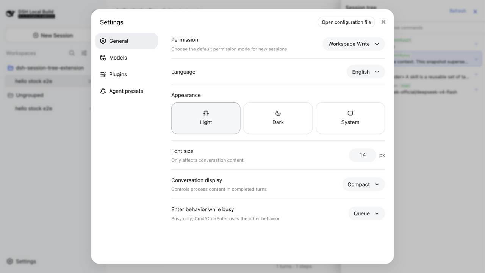
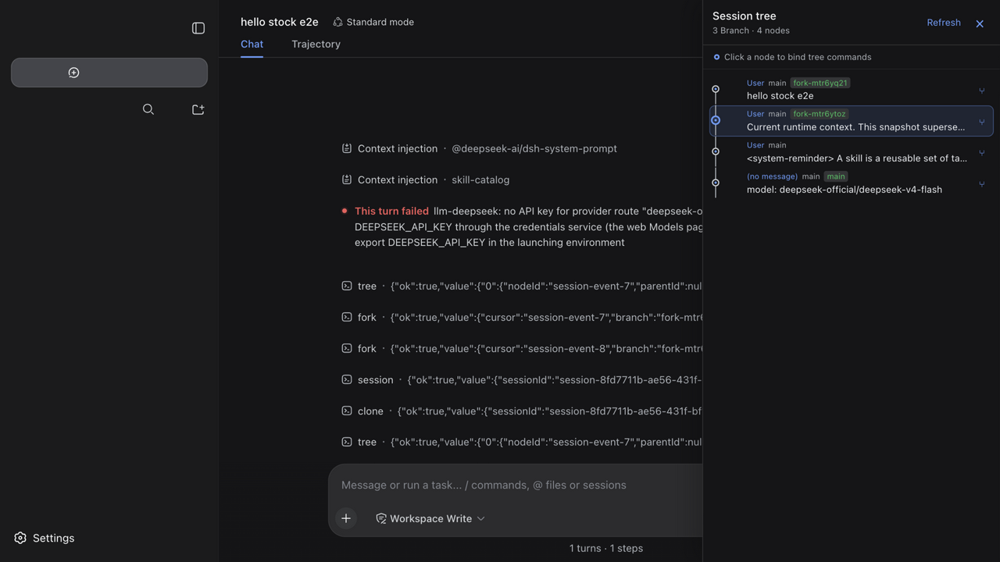
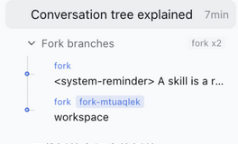

# dsh-session-tree

[](https://www.npmjs.com/package/@robiteame/dsh-session-tree)
[](https://github.com/robiteame/dsh-session-tree-extension/actions/workflows/ci.yml)
[](./LICENSE)
[](https://github.com/deepseek-ai/deepseek-harness)

Append-only, multi-branch conversation trees for
[DeepSeek-Harness](https://github.com/deepseek-ai/deepseek-harness) — branch
from any earlier prompt, clone a branch into a new session, and browse the
whole lineage as one merged WebUI graph. Old history is never edited or
deleted.

Four commands:

| Command | What it does |
|---|---|
| `/tree` | Open the merged lineage graph: every non-subagent session and node; selecting a node moves the tree cursor |
| `/fork` | Branch from an earlier user prompt — the fork appears in the graph and as an inline menu under its source session |
| `/clone` | Duplicate the current conversation into an independent new session under the same project |
| `/session` | Print the current session's tree status and surface mode |

## Screenshots

Tree panel (light and dark) with the sidebar's inline fork-branch menu:





The inline `/fork` branch menu beneath its source session:



Published as four npm packages under the `@robiteame` scope:

| Package | Role |
|---|---|
| [`@robiteame/dsh-session-tree`](./packages/bundle/session-tree) | Carrier Bundle: one install mounts everything below through its composition layer |
| [`@robiteame/dsh-pi-agent-session-tree`](./packages/extensions/pi-agent-session-tree) | Host domain service: the `SessionTree`/`SessionTreeStore` domain model and the `sessionTree` Remote |
| [`@robiteame/dsh-tool-session-tree`](./packages/extensions/tool-session-tree) | Agent surface: the `session_tree` tool and the `/tree` `/fork` `/clone` `/session` commands |
| [`@robiteame/dsh-client-ui-session-tree`](./packages/client/ui-session-tree) | WebUI tree panel: a native tab in the Harness 0.2 right Sidebar, with an additive overlay fallback for older official builds |

## Install (users)

Desktop: **Settings → Plugins → Add plugin**, choose the official npm
registry, install `@robiteame/dsh-session-tree@0.7.3`, then restart. CLI
(`0.2.1-rc.3` or newer):

```sh
dsh plugin --profile <profile> add @robiteame/dsh-session-tree@0.7.3
```

Requires DeepSeek-Harness 0.2.x and Node.js 22+, with no install scripts.
Full steps, the mainland mirror that only serves `0.7.0`, verification, and
uninstall: [INSTALL.md](./INSTALL.md).

## Commands

### `/tree` — open the tree panel

`/tree` opens the right-side panel as one merged graph for the current
session's lineage: ancestors, forks, and clones appear in a single git-style
view, with user messages, assistant replies, tool calls, and model switches
shown as connected nodes. Shared copied prefixes are deduplicated, fork points
carry session badges, and the current session's path stays highlighted.
Selecting a node moves the tree cursor; selecting a node owned by another
session opens that session first. Collapse individual subtrees or whole
session branches to focus the graph.

### `/fork` — branch from a user prompt

`/fork` picks an earlier user prompt and grows a new branch from there: the
conversation continues along the new path while the original one stays intact.
The new session opens with that prompt ready to edit and keeps the completed
turns before it. Selecting the first prompt starts with an empty history.
The child keeps its parent session link. The plugin adds the new branch to the
merged graph and also renders it as an inline collapsible menu directly beneath
its source session's row. Both views follow the official reactive session list,
so new branches appear without a refresh.

### Remove a fork from the session list

Click the trash button on the right of an inline fork row to remove it from
the session list. This uses Harness's native archiving: history is retained
and the session can be restored through the host's archived-session controls.
Child forks remain visible under the nearest unarchived ancestor, and
restoring the parent restores their original nesting. Failed removals show
an error and can be retried. Hosts without native archiving omit the button.

### `/clone` — duplicate into a new session

`/clone` copies the current conversation — through its root path — into an
independent Session under the same project. The source history stays
read-only; the clone is yours to continue separately.

### `/session` — inspect the current tree

`/session` prints the current session's tree status: node, message, and branch
counts, the cursor and active branch, token usage, and the `surface` mode
(`native` or `projection`).

## Branch switching and graceful degradation

The plugin never modifies Harness core files. It capability-detects the
optional branch-selection engine API at runtime:

- **Native mode** — on a checkout carrying
  [`dev/session-branch-surface.patch`](./dev/session-branch-surface.patch)
  (`Session.selectMessageSurface()`), jumping switches the model-visible
  history directly: the next turn starts from the selected node.
- **Projection mode** — on official Harness builds, clicking a node moves the
  tree cursor and leaves the conversation history intact. Use `/fork` to
  continue from an earlier user prompt in a new session. The tree cursor and
  branches are saved under `$DSH_HOME/storages/session-tree/`.

Move the raw `session.jsonl.zstd` between machines together with the matching
sidecar file to retain the tree state.

## How it works

- **Append-only** — every node is immutable; branching and jumping only move
  the cursor. Old branches are never edited or deleted.
- **Every entry is a node** — messages, tool calls, model switches, compaction
  records, and branch summaries all become typed nodes; each has a unique
  `nodeId` and a `parentId` (root is `null`). A node may have multiple
  children — that is the fork.
- **Cursor navigation** — jumping moves the active leaf to a historical node;
  the next append grows a new branch from there. Sibling branches stay intact.
- **LLM context** — the selected path becomes model history in native mode or
  in a new session created by `/fork`.

## Development (contributors)

The repository is a pnpm workspace building the three implementation packages
standalone (no Harness checkout needed):

```sh
pnpm install
pnpm verify      # build + typecheck (host & client) + pack dry-run + vitest
pnpm pack:all    # produce the four tarballs
```

Tests use `vitest` from the repository root against the published Harness
packages (`0.2.1-rc.5`). Earlier releases were also verified against
`0.2.1-rc.2` and `0.2.1-rc.3`. The browser spec in
`packages/client/ui-session-tree` exercises both the 0.2 native right-Sidebar
registration and the older overlay fallback.

### Source integration against a Harness checkout

For debugging against the `dsh-v0.2.1-rc.2` Harness source tag (native branch
switching and source integration):

```sh
dev/install.sh /path/to/deepseek-harness     # applies both dev patches + copies packages
cd /path/to/deepseek-harness && pnpm install && pnpm run build
```

See [`dev/README.md`](./dev/README.md) for what each patch does. This flow is
for contributors only; the source patches have not been validated against
`0.2.1-rc.5`. User installs never touch a Harness checkout.

## License

MIT.
